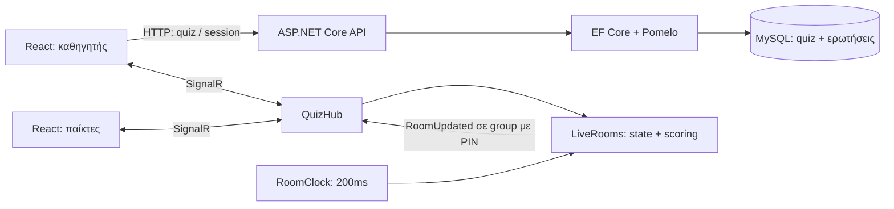

# Αρχιτεκτονική και πρωτόκολλο



## Μηχανή καταστάσεων

`lobby → question → results → question → … → finished`

- `start`: μόνο host, μόνο lobby, τουλάχιστον ένας συνδεδεμένος παίκτης.
- `reveal`: μόνο host, μόνο question. Η ερώτηση μπορεί επίσης να κλείσει από τον server timer ή όταν απαντήσουν όλοι οι εγγεγραμμένοι παίκτες.
- `next`: μόνο host, μόνο results. Μετά την τελευταία ερώτηση οδηγεί σε finished.
- `end`: μόνο host, από οποιαδήποτε μη τελική φάση. Κρατά τους πόντους που έχουν ήδη απονεμηθεί.
- Νέοι παίκτες μπαίνουν μόνο στο lobby. Παλιός παίκτης με έγκυρο token επανασυνδέεται σε κάθε φάση.
- Αποσυνδεδεμένοι παίκτες κρατούν θέση και σκορ. Αν δεν απαντήσουν, ο γύρος περιμένει την προθεσμία ή αποκάλυψη από τον host.
- Σε ισοβαθμία η σειρά εμφανίζεται αλφαβητικά. Οι θέσεις είναι διαδοχικές, δεν απονέμεται κοινή θέση.

## HTTP endpoints

| Method | Path | Περιεχόμενο / πρόσβαση |
|---|---|---|
| GET | `/api/health` | Κατάσταση και όνομα storage provider. Η επιτυχία δηλώνει ότι ξεκίνησε το API, όχι συνεχή έλεγχο DB. |
| POST | `/api/quizzes` | `QuizInput` → id, title, ownerKey, questionCount. |
| GET | `/api/quizzes/{id}` | Quiz με σωστές απαντήσεις. Απαιτεί `X-Quiz-Key`. |
| PUT | `/api/quizzes/{id}` | Νέο `QuizInput`. Απαιτεί `X-Quiz-Key`. |
| POST | `/api/quizzes/{id}/sessions` | `{}` → pin, hostToken. Απαιτεί `X-Quiz-Key`. |

```json
{
  "title": "Ένα quiz για το web",
  "questions": [
    { "text": "Ποιο είναι CSS framework;", "options": ["Tailwind", "MySQL", "SignalR", "Git"], "correctIndex": 0, "seconds": 20 }
  ]
}
```

## SignalR στο `/hubs/quiz`

| Client method | Ορίσματα | Αποτέλεσμα |
|---|---|---|
| `JoinHost` | pin, hostToken | state και κενά player fields |
| `JoinPlayer` | pin, name, playerToken ή null | state, playerId, playerToken, answer |
| `HostAction` | start / reveal / next / end | νέο `RoomUpdated` |
| `Answer` | questionNumber (1-based), option (0-based) | αποδοχή ή HubException, νέο `RoomUpdated` |

Server events: `RoomUpdated` (δημόσιο snapshot) και `RoomExpired` (4 ώρες αδράνειας). Κάθε snapshot έχει αυξανόμενο revision. Το frontend δεν αντικαθιστά νεότερο state με παλιότερη απάντηση join.

Το snapshot περιλαμβάνει κείμενο/επιλογές της τρέχουσας ερώτησης, serverTime/deadline, πλήθος απαντήσεων και δημόσια στοιχεία παικτών. `correctIndex`, κατανομή και νέοι πόντοι εμφανίζονται μόνο μετά το κλείσιμο. Η προσωπική επιλογή επιστρέφεται μόνο στο join του ίδιου παίκτη ή διατηρείται στο τοπικό state μετά από επιτυχημένη αποστολή.

## Αποθήκευση

MySQL: `Quizzes` (Id, Title, OwnerKeyHash, CreatedAt), `Question` (QuizId, Position, Text, τέσσερις επιλογές, CorrectIndex, Seconds). Cascade διαγραφή ερωτήσεων έχει οριστεί στο μοντέλο, αλλά δεν υπάρχει ακόμη endpoint διαγραφής quiz.

Μνήμη server: δωμάτια, tokens συνεδριών, παίκτες, απαντήσεις και σκορ. Browser: localStorage για αναφορές/owner keys, sessionStorage για tickets συμμετοχής. Το room state δεν αποθηκεύεται στη MySQL σε αυτή την έκδοση.
